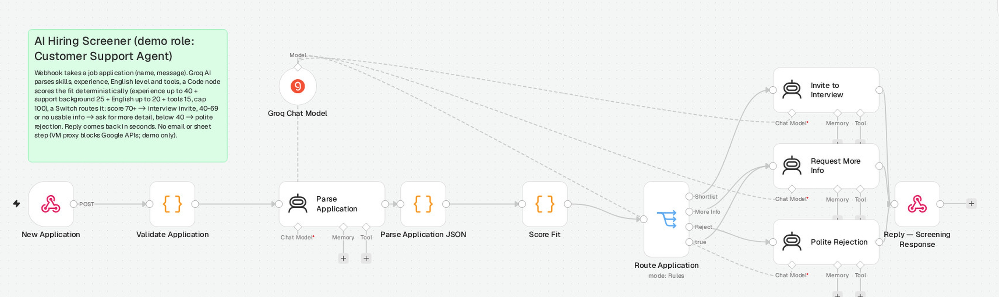

# AI Hiring Screener

An n8n workflow that reads every job application in seconds, scores the fit deterministically, and replies to every applicant — the fit gets an interview invite, the maybe pile gets one question for the missing detail, the rest get a polite no.

## The problem

You posted a job. 200 applications landed. Nobody has read them.

Every application waits while the owner reads CVs after hours — who has the experience, who can actually do the job, who to call back first. The good ones wait. The wrong ones get a reply anyway.

## How it works

1. **New Application** — a webhook receives the application (name, free-text message).
2. **Validate Application** — a Code node checks the message is non-empty and longer than 5 characters.
3. **Parse Application** — an AI agent (Groq) extracts skills, years of experience, support experience, English level, tools and availability.
4. **Parse Application JSON** — a Code node parses the agent's JSON text and normalises years and English level.
5. **Score Fit** — a Code node scores the fit deterministically for the demo role (Customer Support Agent): experience ≥2 years +40 / 1 year +25 / any +10; support background +25; English fluent +20 / good +15 / basic +5; tools +15; capped at 100.
6. **Route Application** — a Switch routes it: Shortlist (70+), More Info (40–69, or no usable info), Reject (under 40).
7. **Invite to Interview** — an AI agent writes the interview invite and asks for 2 time slots.
8. **Request More Info** — an AI agent asks one clear question for the missing detail.
9. **Polite Rejection** — an AI agent writes a warm rejection, keeping the details for future roles.
10. **Reply — Screening Response** — returns the status, score, breakdown and reply.

One Groq Chat Model (gpt-oss-120b) is shared by all four AI agents.

## Live test results

Tested live on the production webhook — 5 out of 5, all HTTP 200 with the exact expected scores.

| Test | Applicant | Result |
|------|-----------|--------|
| A | Ayesha — 3 years of customer support, fluent English, Zendesk | Score **100** — **shortlist**, interview invite |
| B | Bilal — 1 year in retail, basic English, no tools | Score **30** — **reject**, polite no |
| C | Sara — 2 years of customer support, good English, no tools | Score **80** — **shortlist**, interview invite |
| D | Omar — 6-month support internship, good English, HubSpot | Score **65** — **more info**, asked for the missing detail |
| E | Zain — "I want a job, please call me" | Score **0** — **more info**, asked for CV details |

Note: Ayesha's first invite reply came back empty — a transient Groq empty output, not a workflow bug. The immediate retry returned the full invite.

## Try it

1. Import `hiring-screener.json` into n8n.
2. Add a Groq credential and connect it to the Groq Chat Model node (model `openai/gpt-oss-120b`).
3. Activate the workflow and POST a JSON application to `/webhook/screen` with `name` and `message`.
4. The status, score, breakdown and reply come back in the response.

## Limits

- Demo role only (Customer Support Agent) — no real hiring. No email is sent and no sheet row is written — the reply comes back in the webhook response in seconds. (On the self-hosted setup this ran on, the VM egress proxy blocks gmail.googleapis.com and sheets.googleapis.com, so Gmail/Sheets nodes can't work there.)

## Built with

n8n · Groq (gpt-oss-120b) · JavaScript (Code nodes)

Part of a daily series building one real automation for small businesses, every day.
